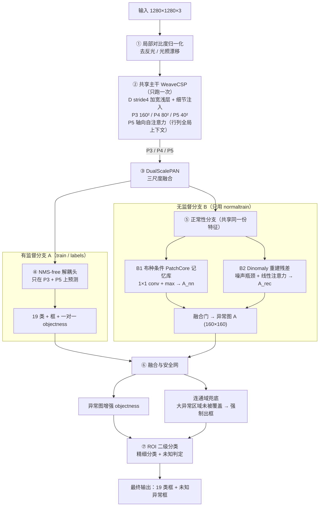

# 经纬 JingWei — 布匹缺陷实时检测新模型设计说明

> 版本 v0.1 · 2026-10-26
> 参考：Dinomaly (CVPR 2025)、PatchCore (Roth et al., 2021)、Ultralytics YOLO27
> 数据：`dataset/dataset.yaml`（19 类，YOLO 格式 train/val + 纯图 normaltrain/normalval）
> 目标分辨率：1280 × 1280

---

## 0. 结论先行

**一句话**：用一个**共享 CNN 主干**同时喂给「有监督 NMS-free 检测头」和「无监督正常性双信号」，
再用一个**确定性安全网**把异常图上任何未被检测框覆盖的大连通域强制输出成框。
这样既拿到 YOLO 级的实时性与 19 类精细分类，又拿到 PatchCore / Dinomaly 级的
"没见过的缺陷也能响应"能力，且对布种变化（经纬粗细 / 经纬密 / 反光）鲁棒。

三个参考工作各自只解决了一部分问题，本设计把它们放在**互补的位置**上：

| 参考 | 它强在 | 它弱在 | 本设计中的角色 |
|---|---|---|---|
| **YOLO27** | 实时、双尺度、NMS-free、分类准 | 只认识标注过的类；漏标 = 漏检 | 主干 + 检测头 + 训练策略（分类/框） |
| **PatchCore** | 只用正常图建模，能发现新异常，大缺陷响应强 | 全图 k-NN 慢；对纹理多模态敏感 | 压缩成 1×1 卷积的**布种条件记忆库** |
| **Dinomaly** | 冻结基础特征 + 噪声瓶颈 + 线性注意力 + 宽松重建，结构异常敏感 | ViT 编码器推理慢，不适合实时 | 蒸馏成 P5 上的**轻量重建残差头**（无第二编码器） |
| **DINOv2** | 自监督、密集 patch 特征、无需缺陷标签 | ViT 推理慢、不能进实时图 | **阶段 0 离线 teacher**：冻结蒸馏进 CNN 后丢弃，推理图不变（[DINO_PRETRAIN.md](DINO_PRETRAIN.md)） |

**已验证**（见 §13）：参考实现在 1280×1280 下 n 变体 **6.36 M 参数 / 16.62 G MACs**，
无 Tensor Core 卡专用的 pico 变体 **2.93 M / 8.09 G MACs**，
64 项单元测试全过（含中文 / Unicode 路径 / 非方形图 / 训练日志 / 断点续训 / numpy RNG / 动态局部+全局注意力前景 / 每 epoch 验证指标 / 未知缺陷框回归），ONNX 导出成功且输出全为静态形状。

> ⚠️ **诚实声明**：仓库里目前只有 `dataset/dataset.yaml`（路径指向你本机的
> `D:/tyhn/yolo/...`），**没有真实图片**。因此本文所有的精度数字都是**设计目标 / 验收指标**，
> 不是实测结果；只有参数量、MACs、张量形状、单元测试、ONNX 导出是实测的。
> 另外 **YOLO27 截至 2026-10 尚未发布权重/配置**（官方文档写明 "not yet available, no launch
> date is set"），所以本设计参考的是它公开的**架构思想**，并在可直接实现的
> YOLO26/YOLO11 风格 CNN 模块上落地；迁移路径见 §12.4。

---

## 1. 需求、约束与验收指标

### 1.1 硬约束

| 编号 | 约束 | 数值 / 说明 |
|---|---|---|
| C1 | 输入分辨率 | 1280 × 1280（不做分块，单张整图一次前向） |
| C2 | 实时性 | 产线上限：单帧端到端 **≤ 25 ms**（≥ 40 FPS）；目标 ≤ 15 ms |
| C3 | 类别数 | 19 类缺陷 + 兜底 "未知异常"（不参与 mAP，但参与召回） |
| C4 | 布种变化 | 经纬线粗细、经纬密、反光会在同一条产线上切换 |
| C5 | 大缺陷 | **一定不能漏**（首要指标） |
| C6 | 分类 | "比较精准"，尤其是形态相近的小类 |
| C7 | 前景/背景 | 必须区分布幅背景与疵点前景；布幅变化导致的边缘正常折入不能误判成疵点 |

### 1.2 可验收指标（在真实 val / normalval 上测）

| 指标 | 目标 | 测量方式 |
|---|---|---|
| **大缺陷召回** `Recall@large` | **≥ 99.5%** | `bbox面积/图幅 ≥ 0.1%` 的 GT，任一类预测框 IoU>0.5 即命中 |
| 正常图误报 `FPR@normal` | ≤ 0.5%（图像级） | `normalval` 中出现任一框的比例 |
| 折入误报 `FPR@fold` | ≤ 0.5% | `normalval` 中含布幅边缘正常折入的子集 |
| mAP50 | ≥ 0.70（视标注质量调整） | 19 类标准 AP |
| 小类分类准确率 | ≥ 0.80 | 蚊虫小黑点 / 小尾巴 / 棉团 / 小布头 / 飘絮 |
| 端到端延迟 P99 | ≤ 25 ms | 目标设备 TRT FP16，含前后处理 |
| 延迟抖动 | P99/P50 ≤ 1.3 | 无 NMS、固定 top-k 的确定性流水线 |

**优先级排序（设计决策时发生冲突时按此顺序）**：
`大缺陷不漏 > 正常图低误报 > 分类精度 > 小缺陷 mAP > 极限 FPS`。
这也是为什么安全网用"宁可多报一个未知框"的策略。

---

## 2. 数据理解

### 2.1 `dataset/dataset.yaml` 解读

```yaml
train: D:/tyhn/yolo/dataset/source5_augmented/images/train/       # YOLO 图片
val:   D:/tyhn/yolo/dataset/source5_augmented/images/val/         # YOLO 图片
normaltrain: D:/tyhn/yolo/dataset/source5_augmented/normal/images/train/  # 纯图，无标签
normalval:   D:/tyhn/yolo/dataset/source5_augmented/normal/images/val/    # 纯图，无标签
nc: 19
names: ['纬线杂质','断纬','多股线','纬线不直','包边不重叠','捻接器接头','小尾巴',
        '经线毛球','包边不良','手工接头','纬斜','短废纱线','单根包不进','棉团',
        '蚊虫小黑点','小布头','稀缝','油点线','飘絮']
```

四类数据各司其职，缺一不可：

| 数据 | 用途 | 参与损失 |
|---|---|---|
| `train` (+ `labels/train`) | 有监督检测：19 类分类 + 框 | 检测损失 |
| `val` | 精度评估、融合阈值调优 | 不参与训练 |
| `normaltrain` | 无监督"正常纹理流形"建模（记忆库 + 重建器） | 宽松重建损失 |
| `normalval` | **阈值标定**（目标 FPR），布种原型验证 | 不参与训练 |

### 2.2 缺陷形态学分组（决定架构）

| 组 | 类别 | 尺寸/形状 | 需要的感受野 | 对应设计 |
|---|---|---|---|---|
| **微小点状** | 蚊虫小黑点、小尾巴、棉团、小布头、飘絮、短废纱线、经线毛球 | 几像素~几十像素 | 极小，需高分辨率 | stride-4 加宽浅层 + 细节注入 P3(160²) |
| **线状/细长** | 断纬、多股线、纬线不直、油点线、捻接器接头、手工接头、纬线杂质 | 长条，方向性强 | 长程水平上下文 | P5 **轴向自注意力**（行注意力一步看全宽） |
| **大型结构** | 包边不良、包边不重叠、单根包不进、纬斜、稀缝、断纬 | 数百像素以上，常贯穿整幅 | 全局 | P5 全局注意力 + **异常图安全网** |

大缺陷的两种失败模式必须同时处理：
1. **检测器漏检**（置信度低 / top-k 截断 / 类别没学好）→ 安全网兜底；
2. **标注漏标**（GT 里没有，监督信号把大缺陷当背景）→ 无监督分支不受标注污染，
   因为它**只在 normaltrain 上训练**。这是引入 Dinomaly/PatchCore 的核心动机之一。

### 2.3 布种变化 = "正常"的多模态分布

经纬线粗细、经纬密、反光三者改变的是**背景纹理**，不是缺陷。对无监督分支来说这是最大风险：
一个单峰的"正常模型"遇到新布种会满屏误报。本设计用三层机制解决（详见 §9）：
输入局部对比度归一化（去反光）→ 布种原型聚类 → 每原型独立记忆库 + 独立分数标准化。

---

## 3. 三个参考工作：取其所长

### 3.1 YOLO27 —— 实时骨架与训练策略

官方文档（[docs.ultralytics.com/models/yolo27](https://docs.ultralytics.com/models/yolo27)）
的关键点，以及本设计的对应实现：

| YOLO27 特性 | 官方说明 | JingWei 对应 |
|---|---|---|
| **双尺度检测 (N/S)** | 去掉中间尺度，只在 fine (小目标) 和 coarse (大目标) 上预测，head 计算量大减 | 只在 **P3 (stride8)** 和 **P5 (stride32)** 挂检测头；P4 只做融合 |
| **加宽浅层** | 早期高分辨率 stage 加宽，改善小目标定位 | stride-4 的 `D` 分支加宽，用深度可分离卷积控制代价，并注入 P3 |
| **前景对齐监督** | 训练时额外分支区分前/背景，缩小 o2m 与 o2o 的 mAP gap，推理时删除 | `fg` 辅助头（训练时）+ 显式 o2m/o2o 双 objectness 分支 |
| **NMS-free** | M/L 用 query-based decoder 直接出框；N/S 可用 `nms=False` | 一对一匈牙利匹配的 `obj_o2o` 分支，推理 top-k + 阈值，**无 NMS** |
| **UltraViT / 深层注意力** | L 在最深 stage 用自注意力捕获全局上下文 | P5 上 40×40 的**轴向自注意力**，O(HW(H+W)C) |
| **固定缩放平衡双尺度** | fused features 上固定 scaling | `balance_p3` / `balance_p5` 可学习标量 |

> 数字参考：YOLO27n 在 640 输入下 7.2 G FLOPs / 3.0 M 参数 /
> 0.44 ms（RTX PRO 6000, TRT11 FP16）。这是 §8 延迟估算的锚点。
> 论文综述见 [arXiv:2510.09653](https://arxiv.org/abs/2510.09653)。

### 3.2 PatchCore —— 正常特征记忆库

[amazon-science/patchcore-inspection](https://github.com/amazon-science/patchcore-inspection)
（"Towards Total Recall in Industrial Anomaly Detection"）的关键点：

| PatchCore 特性 | 本设计对应 |
|---|---|
| 冻结预训练 CNN 的中层特征（layer2/layer3） | 冻结共享主干的 n3 / n5 特征 |
| **局部感知块特征**：3×3 邻域平均池化（`--patchsize 3`） | `PatchFeatureHead` 的 `AvgPool2d(3,1,1)` |
| 多层特征对齐拼接 | n3(160²) 下采样 + n5(40²) 上采样，统一到 80² 网格 |
| 正常图所有块特征组成 memory bank | 每个布种原型一套记忆库 |
| **Coreset 子采样**（`approx_greedy_coreset -p 0.1`） | 提供 `greedy_coreset` 与 `spherical_kmeans` 两种压缩 |
| 最近邻距离 → 异常分数 → 双线性上采样 + 高斯平滑 | 见下方公式；`GaussianSmooth` 平滑 |
| `faiss` k-NN 搜索 | **改成 1×1 卷积 + 通道 max**（关键实时化改造，§5.5） |

### 3.3 Dinomaly —— "少即是多"的重建式异常检测

[guojiajeremy/Dinomaly](https://github.com/guojiajeremy/Dinomaly)（CVPR 2025）的四个要素：

| Dinomaly 四要素 | 官方实现 | JingWei 对应 |
|---|---|---|
| ① Foundation Transformers | 冻结 DINOv2 ViT-B/14，取第 2–9 层分组融合 | 冻结共享主干 + 正交初始化的 `target_proj`；**阶段 0 用离线 DINOv2 蒸馏对齐**（已实现，见 [DINO_PRETRAIN.md](DINO_PRETRAIN.md)） |
| ② Noisy Bottleneck | `bMlp(embed, 4*embed, embed, drop=0.2)`，dropout 即噪声注入 | `NoisyBottleneck(drop=0.2)` + `FeatureJitter` |
| ③ Linear Attention | `LinearAttention2`：ELU+1 特征图，**无 softmax**，"naturally cannot focus" | 同名同实现的 `LinearAttention2`，4 个 `VitBlock` |
| ④ Loose Reconstruction | 不做逐层/逐点 MSE，用 `global_cosine_hm_percent`（hard-mining cosine，p 从 0 升到 0.9） | `HardMiningCosineLoss(p_final=0.9, warmup=1000, factor=0.1)` |

**为什么线性注意力适合异常检测**：softmax 注意力能"聚焦"到异常 token 并把它原样复制到输出，
导致重建误差消失；无 softmax 的线性注意力把信息摊薄到全局，
一个只在正常图上训练过的解码器会把异常输入**拉回正常流形**，
于是 `1 - cos(输入, 重建)` 在异常处变大。这正是本设计 B2 分支的原理。

---

## 4. 总体架构



### 4.1 张量流（1280×1280 输入，n 变体）

| 名称 | 分辨率 | 通道 | stride | 来源 | 用途 |
|---|---|---|---|---|---|
| 输入 | 1280² | 3 | 1 | 相机 | — |
| LCN 输出 | 1280² | 3 | 1 | `LocalContrastNorm` | 去反光 |
| D（细节图） | 320² | 48 | 4 | stem1 | 注入 P3，保留微小缺陷 |
| P3 | 160² | 96 | 8 | stage1 | 小目标检测头 / 块特征 |
| P4 | 80² | 192 | 16 | stage2 | 仅融合 |
| P5 | 40² | 384 | 32 | stage3+SPPF+轴向注意力 | 大目标检测头 / 重建残差 |
| n3 / n4 / n5 | 160²/80²/40² | 96/192/384 | 8/16/32 | PAN | 检测 + 正常性共享 |
| Q（块特征） | 80² | 128 | 16 | `PatchFeatureHead` | 记忆库查询 |
| A_nn / A_rec | 80² | 1 | 16 | B1 / B2 | 异常证据 |
| **A（异常图）** | **160²** | **1** | **8** | 融合+平滑+×2 | 安全网 / objectness 增强 |
| 检测输出 | 160²/40² | 19/4/1 | 8/32 | 头 | 最终框 |

### 4.2 为什么是"一个主干两个分支"

这是整个实时性设计的**最关键决定**：如果在推理时既跑 YOLO 主干又跑 DINOv2 编码器
（Dinomaly 原版做法），1280² 下光 ViT-B/14 就要 > 100 G MACs，绝无实时可能。
本设计让两个分支**复用同一份主干特征**，无监督分支只增加：

- `PatchFeatureHead`：2 个 1×1 投影 + 1 个 1×1 融合 ≈ 0.3 G MACs
- `FabricPrototypeBank.scorer`：1 个 1×1 卷积 (128→256, 80²) ≈ 0.21 G MACs
- `ReconstructionResidual`：40²=1600 token，d=256，4 个线性注意力块 ≈ 4.3 G MACs（含 Linear 与 MLP）

合计约 **4.8 G MACs**，占总量 16.62 G 的 29%；其余约 12.3 G 是共享主干 +
双尺度检测头的卷积（profiler 的 `conv 12.01 G` 中也包含记忆库评分与高斯平滑等小项）。
换句话说：**两个分支并没有各跑一次主干，这是能实时的根本原因。**

---

## 5. 关键模块详解

### 5.1 ① 输入：局部对比度归一化（去反光）

```
mu      = G(G(x))                      G = 15×15 box filter（近似高斯，纯 avg_pool2d）
sigma   = sqrt(G(G((x-mu)^2))) + eps
y       = (x - mu) / sigma
输出    = (y * gamma + beta) * 0.25   gamma/beta 为每通道可学习标量
```

- 只保留**高频织纹结构**，抹掉低频照度/反光梯度；
- 纯 `avg_pool2d`，无参数、可折叠进 TensorRT，只有 2 次访存开销；
- `0.25` 增益把输出拉回合理数值范围，后面接 BN 的 stem 不受影响；
- 与 §9 的布种描述符互为"像素级 / 图像级"两级去反光。

### 5.2 ② 共享主干 WeaveCSP

```
stem0  Conv 3→24, s2        → 640²   （此处唯一密集 3×3）
stem1  DWConv 24→48, s2    → 320²   D（加宽浅层，但用深度可分离控制代价）
stage1 DWConv 48→96, s2    → 160²
       cat(P3, DWConv(D,s2)) → 1×1 fuse → CSPBlock×2     ← 细节注入
stage2 DWConv 96→192, s2   → 80²    CSPBlock×2
stage3 DWConv 192→384, s2  → 40²    CSPBlock×1 → SPPF → 轴向自注意力
```

**轴向自注意力**（针对纬向长缺陷的领域特化）：

```
row-attn:  (B·h·H, W, d) 上做 softmax 注意力   ← 断纬/纬斜沿整行延伸，一步看全宽
col-attn:  (B·h·W, H, d) 上做 softmax 注意力
y = x + BN(proj(row + col))
```

复杂度 `2·B·h·d·H·W·(H+W)`，在 40² / h=6 / d=64 下约 **0.2 G MACs**；
若是全注意力 `(HW)²·C` 则约 1.0 G，且无法导出友好。

### 5.3 ③ 双尺度 PAN + ④ NMS-free 头

- PAN 三尺度融合（top-down + bottom-up），但**只有 n3 / n5 挂头**（YOLO27 n/s 双尺度）；
- 头为解耦结构：`cls_stem/reg_stem`（各 2 个 DWConv）+ 1×1 预测；
- 回归直接输出 `(l,t,r,b)` 距离（DFL-free），`ReLU` 保证非负，乘 stride 解码；
- **两个 objectness 分支共享 cls/reg**：

| 分支 | 训练监督 | 推理 |
|---|---|---|
| `obj`（o2m） | 密集分配，目标 = 预测框与 GT 的 CIoU（IoU-aware varifocal） | 删除 |
| `obj_o2o` | **匈牙利一对一匹配**，只有 matched 点目标=1，其余=0 | 使用 |
| `fg`（前景对齐） | GT 中心 2×stride 半径圆盘 BCE | 删除 |

一对一训练让每个目标只产生一个峰值，推理时 `top-k(300) + 阈值` 即可，
**没有 NMS**——这消除了流水线中唯一"数据相关、延迟无上界"的步骤。

匈牙利匹配代价（`hungarian_match`）：
`cost = -cls_gt - 0.5·obj_o2o - 2.0·IoU(pred_box, gt_box)`，
每个尺度取 top-800 候选，`scipy.optimize.linear_sum_assignment` 求解。

### 5.4 ⑤ 正常性分支总览

```
feats(n3,n5) ──► PatchFeatureHead ──► Q (B,128,80,80), L2-normalized
        │                                   │
        │                                   ├──► B1 记忆库 → d = 1 - max_k<Q,C_k>
        │                                   │         └─ 标准化 + sigmoid → A_nn
        └──► target_proj(P5) [冻结] ──► tgt (B,1600,256)
                    │
              FeatureJitter + NoisyBottleneck(drop=.2)
                    │
              4 × VitBlock(LinearAttention2)
                    │
              rec = normalize(out_proj(LN(·)))
                    │
              res = 1 - <tgt, rec>  → A_rec
```

两者互补：**B1 = 局部纹理新颖度**（点状、异物、油点线），
**B2 = 结构一致性偏离**（断纬、纬斜、稀缝、包边不良——大型缺陷）。

### 5.5 B1 —— 压缩式 PatchCore 记忆库（实时化关键）

原始 PatchCore 在推理时对每个块做 k-NN 搜索（faiss），在 80×80=6400 个位置、
数万个库向量上做最近邻，CPU/GPU 都不实时。本设计做**等价代数变形**：

设块特征 `q ∈ R^D` 与记忆库向量 `c_k ∈ R^D` 都 L2 归一化，则最近邻余弦距离为

```
d(q) = 1 - max_k  <q, c_k>                 (式 1)
```

而 `max_k <q, c_k>` 正是把 `C = [c_1,...,c_K]` 当作卷积核的 **1×1 卷积 + 通道维 max**：

```
cos  = Conv2d(Q, weight=C.reshape(K,D,1,1))     # (B, K, 80, 80)
d    = 1 - cos.max(dim=1)                        # (B, 1, 80, 80)
```

于是整个记忆库变成**一个冻结的 1×1 卷积层**，复杂度 `O(D·K·80²)`
（n: 128×256×6400 ≈ 0.21 G MACs），完全 TensorRT 可融合、延迟确定。

**从"coreset 子采样"到"球心"**：正常图的块特征先按布种分组，
再压缩成 K 个单位向量（默认每原型 K=256）：

- `spherical_kmeans`（默认）：球面上的 k-means，赋值用最大内积，更新后归一化，空簇用覆盖最差样本重置；
- `greedy_coreset`（可选）：PatchCore 的贪心最远点采样，先取代表性真实块，再球心化。

两种压缩都在**离线**完成，推理图里只有 K 个常量权重。

**分数标定**（消除布种间的基线差异）：

```
z   = (d - mu_k) / sigma_k                      mu_k, sigma_k 由 normaltrain 统计
tau_k = quantile(z_normalval, 1 - FPR_target)    FPR_target = 0.005
A_nn = sigmoid((z - tau_k) · slope)
```

`mu_k / sigma_k / tau_k` 都是 buffer，随 checkpoint 走；未出现过的布种原型用
**最保守的 fallback**（`tau = max(tau_k) + 1`），宁可漏也不误报（§13 已验证该分支）。

### 5.6 B2 —— Dinomaly 轻量重建残差

严格复刻 Dinomaly 的"少即是多"四要素，但把编码器换成冻结的共享主干：

1. **冻结基础特征**：`target_proj = Conv2d(c5, 256, 1)` 正交初始化并 `requires_grad_(False)`；
   目标 `tgt = normalize(target_proj(P5).detach())`。冻结防止塌缩解（全零 → 零损失）。
   **阶段 0** 先用 DINOv2-S/14 离线蒸馏这个投影头与主干（§6.1），蒸馏完重新冻结；
   未跑阶段 0 时仍保持正交随机初始化。
2. **噪声瓶颈**：`bMlp` 的 dropout(0.2) 即噪声注入；再加 `FeatureJitter(0.3)` 扰动。
3. **线性注意力**：`LinearAttention2` 用 ELU+1 特征图，无 softmax：
   `kv = Σ k⊗v`, `z = 1/(q·Σk)`, `out = kv·q·z`。4 个 `VitBlock`。
4. **宽松重建**：损失只在最难的一部分块上算 cosine，不做逐点 MSE（§7）。

推理残差：

```
res(h,w) = 1 - cos(tgt, rec)                    # (B,1,40,40)
A_rec    = sigmoid((res - tau_rec) · slope_rec)
```

`tau_rec / slope_rec` 由 `normalval` 的残差分布分位数标定。

> **为什么推理时不需要 teacher**：Dinomaly 原版用冻结 ViT 作 encoder、
> 可训练 ViT 作 decoder，两者都在推理图上。本设计把 "encoder" 换成
> **训练好的共享主干**（阶段 B 时冻结），"decoder" 换成 4 个线性注意力块。
> 因此推理时没有任何额外编码器，只有 4.3 G MACs 的轻量头。

### 5.7 融合门与安全网

**融合门**：`A = sigmoid(Conv1x1([A_nn, A_rec]))`，2→1，初值 `[α, β] = [0.6, 0.4]`
（也可设 `fusion: fixed` 用固定权重）。随后 `GaussianSmooth(7×7, σ=2)` +
`×2` 上采样到 160×160。

**三条融合规则**：

1. **objectness 增强**：`obj_o2o_logit += g · A(x,y)`（默认 `g=1.0`）。
   有异常证据的位置更容易进入 top-k，分类仍由监督头给出 → 分类精准。
2. **确定性安全网**（核心，伪代码）：

```python
A = A * fabric_mask * (1 - fold_attenuation * fold_band * (1 - defect_fg))
mask = A >= anomaly_thresh                       # 160×160 二值图
mask = dilate(mask, 3×3)                          # 连接断裂的长缺陷
for cc in connectedComponents8(mask):
    if area(cc) < 0.001 * 160²: continue         # 只看"大型"连通域
    if peak(A[cc]) < anomaly_thresh: continue
    if valid_frac(cc) < min_fabric_frac: continue     # 背景
    if fold_like(cc) and peak < fold_peak_override: continue  # 正常折入
    # 小未知疵点由 fusion.emit_unknown_boxes / unknown_min_area_ratio 控制，
    # 大异常连通域永远保留，不受 max_unknown_boxes 限制。
    box = bbox(cc) * 8 * margin                  # 映射回 1280 像素坐标
    if max IoU(box, 已有检测框) > 0.1:
        boost(那些框的分数)                       # 已检出 → 不重复出框
    else:
        emit(box, score=0.9*A_peak, label=19 /*未知异常*/)   # ★ 兜底
```

3. **ROI 二级分类**：对所有最终框在 n3/n5 上做 `grid_sample` ROI 池化 →
   MLP 输出 20 logits（19 类 + 未知），与检测头分数做 logit 级融合。
   这一步专治形态相近的小类（蚊虫小黑点 vs 小黑点 vs 油点线）。
   低置信度时宁可输出"未知异常"也不给错类 → 分类"比较精准"。

### 5.8 前景/背景分离与布幅边缘折入抑制（局部+全局注意力）

布幅左右移动 / 宽度变化时，布边正常折入会形成长条状暗区，原安全网会把它
当成大缺陷输出 `未知异常`。**折入在图像上的像素位置并不固定**，所以旧版
“距图像边缘固定 64 px 的带”是错的。当前实现改为类似 Transformer 的
**局部 + 全局注意力**上下文头 `FabricContext`
（详见 [FOREGROUND.md](FOREGROUND.md)）：

- **局部分支**：在 stride-8 的 P3 上用 depthwise conv + GroupNorm 提取织纹、
  暗条、缺陷边缘等像素级特征；
- **全局分支**：在 stride-32 的 P3/P5 token 上加可学习 `[CLS]`，经过
  `LinearAttention2`（Dinomaly 同款 ELU+1 线性注意力）`VitBlock` 堆叠，
  得到整幅图的布幅位置 / 宽度 / 背景先验；`[CLS]` 输出生成 FiLM (γ, β)
  调制局部特征；
- **三个 1×1 头**输出动态每帧图：
  - `defect_fg`：YOLO 框内缩区域作正样本，正常图 / 折入图作负样本；
  - `fabric_mask`：由亮度归一化织纹能量伪目标 + 网络修正得到布面 mask；
  - `fold_band`：由动态布面边界的形态学伪目标 + 网络修正得到折入带，
    **跟随布边移动，而不是固定图像边缘像素**；
- 训练时另用 `build_fabric_context_targets()` 生成逐帧伪目标并监督 CLS 头的
  全局布幅占比；伪目标只在 loss 中使用，推理图不含 numpy / 形态学算子。

有效异常图：

```
A_eff = A * fabric_mask * (1 - fold_attenuation * fold_band * (1 - defect_fg))
```

`A_eff` 同时喂给 objectness 增强和安全网；三个上下文图打包成
`context (1,3,G,G)` 一起导出。安全网对大异常连通域额外检查：
布面占比低于 `min_fabric_frac` → 背景跳过；
位于动态 `fold_band` 且 `defect_fg` 低、峰值未超过 `fold_peak_override`
→ 判为正常折入跳过（长宽比只是默认关闭的可选辅助）；
`defect_fg` 高或峰值极高 → **仍然兜底输出**，因此 §5.9 的召回下界不变。

`data.py` 还以 25% 概率合成边缘折入增广（只改亮度、不移动框），让
normaltrain / 记忆库与 detector 都把折入见成正常背景。注意力头在
stride-32 token 上计算，1280² 下只增加约 0.12~0.26 G MACs。
`fusion.emit_unknown_boxes` 默认开启，使未知疵点类型也生成 `未知异常` 框；
验证指标、大数据集训练速度与 1660S 实时命令见
[CACHE_AND_VALIDATION.md](CACHE_AND_VALIDATION.md)。

### 5.9 "大缺陷一定不漏"的形式化说明

设上下文门控后的有效异常图 `A_eff` 对大缺陷的召回为 `R_A`
（大缺陷区域内 `A_eff ≥ thresh` 且连通域面积达标），
则最终大缺陷召回满足：

```
Recall_large ≥ R_A + (1 - R_A) · R_det
```

其中 `R_det` 是监督检测头自身的召回。安全网的兜底规则是**确定性**的：
只要异常图上有达标连通域，就一定至少产生一个框（未知类也算命中）。
因此：

- 即使 `R_det = 0`（检测器完全失效），仍有 `Recall_large ≥ R_A`；
- 大缺陷在结构上（大面积织纹破坏）同时触发 B1（局部纹理新颖）与 B2（结构偏离），
  两类信号互补使 `R_A` 很高；
- **残余风险**：只有当大缺陷在 A 上也不显著时才漏，
  这靠 §9 的布种自适应 + `normalval` 阈值标定 + 训练时合成异常增广来压低；
- **前景上下文不破坏下界**：§5.8 的局部+全局注意力
  `fabric_mask / fold_band / defect_fg` 只跳过「背景 + 低前景动态折入状」
  连通域；真实大缺陷要么 `defect_fg` 高、要么峰值超过 `fold_peak_override`、
  要么不在预测折入带，仍进入上述确定性兜底。固定图像边缘像素不再参与判定。
  `emit_unknown_boxes` 还会把较小的未知异常连通域也标成 `未知异常` 框，
  大缺陷兜底不受 `max_unknown_boxes` 限制。

> 严格地说，"100% 不漏"是工程保证而非数学定理：本设计把问题从
> "检测器必须召回" 转化为 "异常图必须召回"，后者由双无监督信号 +
> 确定性规则共同保证，并在 §10 用 `Recall@large` 专项指标验收。
> 这是任何纯检测器方案都做不到的。

---

## 6. 训练流程（阶段 0 + 5 个阶段）

| 阶段 | 数据 | 训练对象 | 损失 | 输出 |
|---|---|---|---|---|
| **0**（建议） | normaltrain | 主干 + neck + `target_proj` + `patch`（DINOv2 离线蒸馏对齐） | 特征 cosine | `runs/dino/dino_init.pt`，`target_proj` 重新冻结 |
| **A** | train（YOLO 标签） | 主干 + PAN + 头 + ROI | 检测损失（§7） | `runs/detector/last.pt` |
| **B** | normaltrain | PatchFeatureHead + 重建器 + 融合门（**主干冻结**） | 宽松重建损失 | `runs/normality/normality.pt` |
| **C** | normaltrain + normalval | 无梯度 | — | 布种原型 + 记忆库 + 标定 (`memory_bank.pt`) |
| **D** | val + normalval | 融合阈值（网格搜索，网络只跑一次） | 目标函数 | `fusion_calibrated.yaml` |
| **E** | — | — | — | ONNX / TRT 导出 |

对应命令（详见 `docs/TRAINING.md` 与 [DINO_PRETRAIN.md](DINO_PRETRAIN.md)）：

```bash
# 阶段 0（建议）：DINOv2 离线 teacher 蒸馏，teacher 不进推理图
python tools/pretrain_dino.py    --cfg configs/jingwei_n.yaml --teacher dinov2_vits14
python tools/train_detector.py   --cfg configs/jingwei_n.yaml --resume runs/dino/dino_init.pt
python tools/train_normality.py  --cfg configs/jingwei_n.yaml --ckpt runs/detector/last.pt
python tools/build_memory_bank.py --cfg configs/jingwei_n.yaml --ckpt runs/normality/normality.pt
python tools/calibrate_fusion.py --cfg configs/jingwei_n.yaml --ckpt runs/bank/memory_bank.pt
python tools/export.py           --cfg configs/jingwei_n.yaml --ckpt runs/bank/memory_bank.pt
```

### 6.1 阶段 0：DINOv2 离线蒸馏（不是在线 DINOv2 推理）

从随机权重直接训练 19 类细粒度缺陷 + 无监督正常性分支，需要大量标注；
DINOv2 是自监督模型，能提供无需标签的密集 patch 特征。做法是把
**冻结的 DINOv2 ViT 当 teacher**，只在训练阶段跑，student 仍是本设计的轻量 CNN：

- teacher 看弱增广的 `normaltrain` 裁剪图，输出 patch token 图 \(T\)；
- student 看同位置的强增广图，把 `n3 / n5 / target_proj / patch` 四个尺度经
  训练期 1×1 投影后与 \(T\) 做 cosine 对齐；
- 阶段 0 结束后丢弃 teacher 和辅助投影，`target_proj` 重新冻结，
  checkpoint 作为阶段 A 的 `--resume` 初始化。

因此**推理图没有任何 ViT，MACs / ONNX 输出 / 1660S 实时性全部不变**。
完整命令、teacher 选择、许可证与 A/B 验证见 [DINO_PRETRAIN.md](DINO_PRETRAIN.md)。

**阶段 B 的关键约束**：主干 / neck / 头 / ROI 全部 `requires_grad_(False)`，
BN 置 eval（固定统计量）→ 目标特征稳定；只有正常性分支可训练。
否则会出现"主干把特征压成常数 → 重建损失为 0"的塌缩解。

**数据增广**（`jingwei/data.py`）：
- 几何：hflip / vflip / rot90 + **各向异性缩放**（模拟经纬密变化，框同步变换）；
- 光度：亮度/对比度、低频照度场（反光）、模糊/锐化（纱线粗细）；
- 类别不均衡：`class_weights`（可选 19 维）、focal 调制、稀有类过采样；
- 可选：CutPaste / 合成断纬 / 合成稀缝 用于增强 B 分支的异常边界（仍只用正常图）。

---

## 7. 损失函数汇总

```
总损失 = Σ_i w_i · L_i

① 密集（o2m）分类： Varifocal 风格
   L_cls_o2m = Σ ( BCE_with_logits(cls, onehot·q) · |σ(cls) - onehot·q|² · class_weight ) / N_pos
   q = CIoU(pred_box, assigned_gt)              # IoU-aware 软标签

② 密集（o2m）objectness：
   L_obj_o2m = mean( BCE(obj, q) · (1 + 3·pos) )

③ 密集（o2m）框：
   L_box_o2m = mean(1 - CIoU(pred, gt)) + 0.1·L1(pred_dist, gt_dist)

④ 一对一（o2o）objectness（部署分支）：
   matched by Hungarian(cost = -cls_gt - 0.5·obj - 2·IoU)
   L_obj_o2o = BCE(pos) + top-K hard negatives BCE
   K = max(3N, o2o_neg_ratio·H·W, o2o_min_neg)  # per scale, capped by free cells

⑤ 一对一 cls / box： matched 点上 BCE(onehot) + (1-CIoU) + 0.1·L1

⑥ 前景对齐（训练辅助，YOLO27 思想）：
   L_fg = BCE(fg, 以 GT 中心为圆心 2·stride 半径的圆盘)

⑦ Dinomaly 宽松重建（只用 normaltrain）：
   p(it) = min(0.9, 0.9 · it / 1000)
   L_rec = mean(topk_{p(it)%}(1 - cos(tgt, rec))) + 0.1·mean(1 - cos(tgt, rec))
```

默认权重（`configs/jingwei_n.yaml`）：
`cls_o2m 1.0, box_o2m 2.0, obj_o2m 1.0, cls_o2o 1.5, box_o2o 2.0,
obj_o2o 1.5, fg_align 0.5, rec 0.5`。

---

## 8. 实时性预算（实测 MACs + 参考标定延迟）

### 8.1 实测计算量（`tools/benchmark.py`，hook-based MAC counter）

> 下表已包含 §5.8 新的局部+全局注意力前景头；注意力部分约 +0.12~0.26 G MACs。

| 变体 | 参数 | 640² MACs | **1280² MACs** | conv | linear | attention |
|---|---|---|---|---|---|---|
| **jingwei_p**（无 TC 卡专用） | 2.93 M | 2.45 G | **8.09 G** | 6.39 G | 1.58 G | 0.12 G |
| **jingwei_n** | **6.36 M** | 5.11 G | **16.62 G** | 12.01 G | 4.40 G | 0.21 G |
| **jingwei_s** | 11.48 M | 10.05 G | **34.11 G** | 29.45 G | 4.40 G | 0.26 G |

对照：YOLO27n 官方 640² = 7.2 G FLOPs / 3.0 M 参数。
按像素线性外推到 1280² 约 28.8 G；**JingWei-n 在 1280² 只有 16.62 G，
约为其六成**，因为双尺度头 + 深度可分离浅层。

> MAC counter 只统计 Conv2d / Linear / 自定义注意力；池化、BN、softmax、
> `LocalContrastNorm` 的两次 box filter、高斯平滑（<0.001 G）未计入，
> 这些是**访存受限**算子，已计入下面的固定开销。

### 8.2 参考标定延迟（估算，非实测）

锚点：YOLO27n 7.2 G MACs → 0.44 ms（RTX PRO 6000，TRT11 FP16，640px）。
`base = 0.44 × (MACs/7.2G) × 1.6`，`1.6` 是深度可分离/访存受限算子的惩罚，
再加 `1.2 ms` 固定开销（局部对比度归一化、160² 连通域、解码、H2D/D2H、kernel launch）。

| 设备 | jingwei_n | jingwei_s |
|---|---|---|
| RTX PRO 6000（参考） | **2.83 ms / 354 FPS** | 4.54 ms / 221 FPS |
| RTX 4090 | 3.64 ms / 275 FPS | 6.20 ms / 161 FPS |
| RTX 3060 | 7.70 ms / 130 FPS | 14.54 ms / 69 FPS |
| Jetson AGX Orin | 14.20 ms / 70 FPS | 27.88 ms / 36 FPS |

**结论**：n 变体在主流 GPU / 边缘设备上都留有很大余量（>> 40 FPS 需求）；
s 变体在 Jetson 上约 36 FPS，仍可用。**必须用 `trtexec` 在目标设备实测**，
上表只是选型依据。

> ⚠️ **上表只适用于有 Tensor Core 的 GPU**。GTX 1660 SUPER / 1660 Ti / 1650
> （TU116/TU117，sm_75 但**无 Tensor Core**）不能用这个锚点：它们 FP32 仅
> 5.03 TFLOPS，FP16 只是 2:1 的 shader 速率，且 TRT 的 FP16 卷积常常落到比
> FP32 Winograd 更慢的 kernel。**注意：这只是不能用 Tensor-Core 锚点，
> 不是不能用 TensorRT**——1660S 的 sm_75 可以正常构建 TRT engine，
> 只是 FP16/INT8 没有 TC 加速；术语澄清见 [DEPLOYMENT.md §4.1](DEPLOYMENT.md)。
> 按独立的峰值×效率模型估算：
> **p 13.2–20.1 ms ✅ / n 22.9–37.0 ms ⚠️临界 / s 42.8–71.8 ms ❌**。
> 完整分析、A/B 步骤与实测脚本见 [DEPLOYMENT.md §4.1](DEPLOYMENT.md)。
> 用 `tools/bench_device.py --cfg configs/jingwei_p.yaml --precision both` 在你的卡上验证。

### 8.3 实时性的 8 个具体手段

1. **单主干共享**：无第二编码器（对比 Dinomaly 原版省 > 100 G MACs）；
2. **双尺度检测**：砍掉 P4 检测头（YOLO27 思想）；
3. **记忆库卷积化**：k-NN 搜索 → 1×1 conv + max（省掉 faiss / 动态索引）；
4. **P5 轴向注意力**：O(HW(H+W)C) 而非 O((HW)²C)；
5. **无 NMS**：一对一分支，top-k 固定上界，延迟确定；
6. **低分辨率后处理**：连通域在 160² 上做，不是 1280²；
7. **前景上下文局部+全局注意力**：局部 depthwise conv 在 stride-8，
   全局 `LinearAttention2` 只在 stride-32 token（40×40+1）上跑，
   `fabric_mask / fold_band / defect_fg` 三个 1×1 头输出动态布边；
   注意力部分仅约 +0.12~0.26 G MACs，且全静态、ONNX/TRT 友好；
8. **FP16 / INT8 TRT + Conv-BN 折叠 + 训练辅助分支导出即删**。

### 8.4 延迟确定性

流水线中没有任何随检测结果数量变化的循环：
`top_k=300` 固定、连通域个数有上界（160²/最小面积）、ROI 数量 ≤ 300+上界。
因此 `P99/P50` 抖动主要来自 GPU 频率与相机 I/O，而不是算法。

---

## 9. 布种自适应：三层机制（针对经纬粗细 / 经纬密 / 反光）

```
第 1 层（像素级）：LocalContrastNorm
    去低频照度与反光 → 网络看到的是"结构"而不是"亮度"

第 2 层（图像级）：布种描述符 + K 原型
    gray → 高通 → 2D FFT 功率谱 → 行列边际能量 → 主频 → 周期(经纬密)
    8-D descriptor = [period_warp, period_weft, peak_warp, peak_weft,
                      ratio, grad_mean, lap_var, local_contrast]
    k-means → K 个布种原型（n: K=8, s: K=12）
    推理时 O(1) 取最近原型

第 3 层（特征级）：每原型独立记忆库 + 独立分数标准化
    centroids[k], mu[k], sigma[k], tau[k]
    切换布种时只需把第 k 组 centroids 拷进 scorer 的 1×1 卷积权重
    （导出时可固定一个原型，或做 K 路并行 conv）
```

**为什么描述符能抵抗反光**：先做 25×25 高通去掉低频照度场，
**再**在高通信号上做 z-score 归一化。若先对原图归一化，反光的大方差会把织纹幅度
除小，导致描述符随反光强度漂移。这个顺序是实测验证过的（§13）。

**布种增广**：训练时对正常图与缺陷图做各向异性缩放（改变经纬密）、
低频照度场（反光）、模糊/锐化（纱线粗细），使监督分支也学到布种不变性。

**新布种上线流程**：只需追加 normaltrain 图片 → 重跑阶段 C（分钟级），
无需重新训练检测器；若新布种的描述符落在未填充原型，用保守阈值兜底。

---

## 10. 评估方案

### 10.1 指标

```bash
python tools/evaluate.py --cfg configs/jingwei_n.yaml --ckpt runs/bank/memory_bank.pt
```

输出：`mAP50`、每类 `AP50`、**`large-defect recall`**（首要）、
`normal image FPR`、参数量 / MACs、端到端 FPS。

### 10.2 专项测试

| 测试 | 做法 | 通过标准 |
|---|---|---|
| 大缺陷不漏 | 按面积 ≥0.1% 过滤 GT，统计 IoU>0.5 命中率 | ≥ 99.5% |
| 漏标鲁棒性 | 人工从 val 中删掉 20% 大缺陷标注后评估 | 召回下降 < 1%（安全网应兜住） |
| 布种泛化 | 按布种原型分组评估，含训练未见的布种 | 组间 FPR 差异 < 2× |
| 反光鲁棒性 | 对 normalval 加合成照度梯度 | FPR 上升 < 0.3% |
| 新异常发现 | 构造未见缺陷（合成油渍/撕裂） | 至少输出"未知异常"框 |
| 延迟 P99 | 1000 帧连续推理 | ≤ 25 ms, P99/P50 ≤ 1.3 |

### 10.3 消融实验（建议）

| 配置 | 验证什么 |
|---|---|
| 只监督头（关 normality） | 安全网对大缺陷召回的贡献 |
| 只 B1 记忆库 / 只 B2 重建 | 两个无监督信号是否互补 |
| 无布种原型（单记忆库） | 布种自适应对 FPR 的贡献 |
| 有 / 无 LocalContrastNorm | 反光鲁棒性 |
| 有 / 无 ROI 二级分类 | 小类分类精度 |
| 有 / 无 P5 轴向注意力 | 线状/大缺陷 mAP |
| 三尺度 vs 双尺度 | 实时性与精度的权衡 |
| K ∈ {64,128,256,512} | 记忆库容量 vs 延迟 |

---

## 11. 风险、边界与失败模式

| 风险 | 表现 | 缓解 |
|---|---|---|
| 标注里"大缺陷"被当背景 | 监督头被压制 | 无监督分支只用 normaltrain，不受污染；安全网兜底 |
| 布种差异过大（如针织 vs 机织） | 单 K 原型不够 | 增大 K；或按布种显式给定 prototype id（产线 MES 通常知道布种） |
| 反光是**高频**的（镜面高光、条纹灯） | LocalContrastNorm 去不掉 | 增加偏振/漫射光源；增广里加高频条纹；必要时在相机端解决 |
| 大缺陷与正常纹理相似（如同色纬斜） | B1 不响应 | 靠 B2 结构重建 + 轴向注意力；补充少量合成纬斜样本 |
| 未知异常框太多导致 FPR 高 | 安全网误报 | `anomaly_thresh` / `target_fpr` 标定；只对面积 ≥0.1% 的连通域兜底 |
| 类别极度不均衡 | 稀有类 AP 低 | `class_weights`、focal、过采样、ROI 二级分类 |
| YOLO27 未发布 | 无法直接用其权重 | 见 §12.4 迁移路径 |
| 1280² 下小缺陷仍太小 | 8px 一个 cell | 已在 stride-4 保留细节图；若不足可把输入改成 tile 推理（见下） |

**关于 "100% 不漏" 的边界**：确定性安全网保证的是
"异常图上出现达标连通域 ⇒ 一定出框"。如果某个大缺陷在两种无监督信号下
都不显著（如与正常纹理同分布的"隐形"缺陷），仍会漏。
因此验收必须同时看 `R_A`（异常图召回）与 `Recall@large`，
并在产线用 §10 的漏标鲁棒性测试持续监控。

---

## 12. 实现映射与迁移路径

### 12.1 文件结构 ↔ 设计

```
configs/jingwei_n.yaml / jingwei_s.yaml   模型与训练超参（本文所有数字来源）
configs/jingwei_p.yaml                    无 Tensor Core 卡（1660S）专用精简变体 → §12.2 / DEPLOYMENT §4.1
configs/fabric19.yaml                     可移植的数据配置（19 类 + 形态分组）
dataset/dataset.yaml                      你原来的数据配置（保持不动，作为类别真源）
jingwei/
  layers.py      LocalContrastNorm / CSP / DWConv / SPPF / AxialAttention / GaussianSmooth
  backbone.py    WeaveCSP（含细节注入）           → §5.2
  neck.py        DualScalePAN                     → §5.3
  head.py        双分支 NMS-free 解耦头            → §5.3
  normality.py   PatchFeatureHead / FabricPrototypeBank /
                 NoisyBottleneck / LinearAttention2 / ReconstructionResidual  → §5.4–5.6
  fusion.py      ROI 池化 / 连通域安全网           → §5.7
  losses.py      检测损失 + 匈牙利 + 宽松重建损失   → §7
  fabric.py      布种描述符 / 原型聚类 / 记忆库压缩 → §9
  data.py        YOLO 数据集 / 纯正常图集 / 布种 / 折入增广 → §6
  foreground.py 局部+全局注意力 / 动态布幅掩膜 / 折入带 / 缺陷前景头 → §5.8
  image_io.py   中文/Unicode 安全的图像与视频 I/O → §12.5
  utils.py      框工具 / MACs profiler / 安全 torch_load（weights_only=True）
  dino.py       阶段 0 DINOv2 离线 teacher 工具
  model.py       JingWei 顶层（训练 / 推理 / 导出）
tools/           阶段 0 + A–E 的 CLI（pretrain_dino / train /
                 build / calibrate / evaluate / predict / export / benchmark /
                 bench_device）
tools/_common.py 共享数据/模型加载 + log()/format_eta() 进度日志 +
                 save_checkpoint()/resume_checkpoint()/RNG 断点续训工具
tests/test_model.py  64 项单元测试（含验证指标 / 未知缺陷框）
docs/DESIGN.md   本文
docs/TRAINING.md 训练与数据准备手册
docs/DEPLOYMENT.md 实时部署手册
docs/FOREGROUND.md 局部+全局注意力前景/背景与动态折入抑制
docs/CACHE_AND_VALIDATION.md 验证指标 / 大数据集速度 / 未知框 / 1660S 实时
docs/DINO_PRETRAIN.md 阶段 0 DINOv2 蒸馏
```

### 12.2 两个变体的选择

- **jingwei_n**（默认）：6.36 M / 16.62 G，实时优先，建议先用它跑通产线；
- **jingwei_s**：11.48 M / 34.11 G，精度优先，边缘设备上仍 ~36 FPS；
- **jingwei_p**（pico）：2.93 M / 8.09 G，专为**无 Tensor Core 的老卡**
  （GTX 1660 SUPER / 1660 Ti / 1650）在 1280² 下实时而裁剪：
  通道 ×0.75、重建块 4→2、网格 80→64、记忆库中心 256→128、关闭 ROI 二级分类。
  **LocalContrastNorm、布种原型、双无监督信号、局部+全局注意力动态前景/折入上下文、确定性安全网全部保留**，
  即"大缺陷不漏"与"边缘折入不误报"的机制都没有被削弱。预测时
  `python tools/predict.py --cfg configs/jingwei_p.yaml --realtime-1660` 会自动
  检测 1660/1650/TU116/TU117 并强制 pico + FP32 + 实测 P99。详见
  [DEPLOYMENT.md §4.1](DEPLOYMENT.md)、[FOREGROUND.md](FOREGROUND.md) 与
  [CACHE_AND_VALIDATION.md](CACHE_AND_VALIDATION.md)。
- 若需要更高精度，可把 `attn_heads` / `recon_dim` / `n_centroids` 调大，
  或把 `top_k` 从 300 提到 500（对延迟影响很小）。

### 12.3 分块推理（可选扩展）

若实测发现 <8 px 的微小缺陷在 stride-8 上仍丢失，可保留同一模型，
把 1280² 切成 4 个 720² 重叠 tile（overlap 80 px）分别推理再合并，
代价是 ~1.27× 计算量；或直接把 `grid`/`out_grid` 提到 320²（+0.8 G MACs）。

### 12.4 YOLO27 迁移路径（重要）

截至 2026-10-26，[官方文档](https://docs.ultralytics.com/models/yolo27)明确说明
YOLO27 "models are not yet available, and no launch date is set"，权重/配置/代码均未发布。
因此本仓库是**自包含的等价实现**（YOLO26/YOLO11 风格 CNN + 上述创新）。
待 YOLO27 发布后：

1. 用 `YOLO("yolo27n.pt").model` 的 backbone 替换 `WeaveCSP`（保持 stride 4/8/16/32 与通道数），
2. 用其 NMS-free 头替换 `NMSFreeDetect`（若其 head 已含一对一分支，可直接去掉我们的 o2m 分支），
3. 复用其 `nms=False` 的导出路径，
4. **normaltrain / 记忆库 / 安全网 / 布种自适应部分完全不用改**——它们与主干解耦。

也就是说，YOLO27 是本设计的**可插拔升级件**，不是前置依赖。

### 12.5 中文 / Unicode 文件名（Windows 必读）

真实数据常放在 `D:/布匹数据/.../图片 001.jpg` 这类路径下。Windows 上某些
OpenCV 构建的 `cv2.imread` / `cv2.imwrite` / `cv2.VideoCapture` 接收窄字符串，
遇到非 ASCII 路径会返回 `None` / `False` 或抛异常；`cv2.putText` 的 Hershey
字体也不能可靠绘制中文类名。本实现把全部 I/O 收敛到 `jingwei/image_io.py`：

| 操作 | 实现 | 原因 |
|---|---|---|
| 读图 | `np.fromfile(path, uint8)` + `cv2.imdecode` | Python 文件 API 支持 Unicode 路径，绕过 OpenCV 路径编码 |
| 写图 | `cv2.imencode(ext, img)` + `ndarray.tofile(path)` | 同上；扩展名取自 `pathlib` 后缀，支持大写 `.JPG/.PNG/.WEBP` |
| 视频 | `VideoCaptureUnicode`（非 ASCII 本地路径复制到临时 ASCII 文件再打开） | `cv2.VideoCapture` 无法可靠处理中文路径；退出时删除临时副本 |
| 图上文字 / 评估表 | `ascii_safe()`：中文类名在图上 / 控制台表格里退化为 `cls<id>` | Hershey 字体只有 ASCII；中文类名仍完整写入 `results.json` |
| 其它控制台输出 | `console_safe()` 把非 ASCII 转成 `\uXXXX` | 避免 Windows 控制台 `UnicodeEncodeError` |

因此 `dataset.yaml` 的 `D:/中文目录/...`、`predict.py --source 中文图.jpg --out 中文目录`、
中文 `.npz` 原型、中文视频名、中文类别名都**不需要改名**。回归测试
`test_24_unicode_paths` 覆盖 `read_image` / `descriptors_for_folder` /
`VideoCaptureUnicode` / `predict.py` 图片与视频端到端；`test_14` 另覆盖
中文 YOLO 标签文件名。所有工具都不再直接调用 `cv2.imread` / `cv2.imwrite`。

### 12.6 非方形布幅图与 checkpoint 加载

产线相机常输出 `1040×2448` 这类长条非方形帧。`fabric_photometric` 里的
反光场是单通道低频图，经 `cv2.resize` / `GaussianBlur` 后 OpenCV 会把
`(H, W, 1)` 压成 `(H, W)`；旧代码直接用它与 `(H, W, 3)` 相乘，触发
`ValueError: operands could not be broadcast together`。现在在相乘前显式
补回 `field[:, :, None]`，并把灰度/单通道输入统一扩成 3 通道；`test_25`
同时覆盖直接增广调用和 `YOLODefectDataset(augment=True)` 全路径。

PyTorch 2.6+ 对 `torch.load` 默认 `weights_only=False` 会发 `FutureWarning`。
所有 checkpoint 读取统一走 `jingwei.utils.torch_load`，默认
`weights_only=True`；若第三方 DINOv1 权重里含 `argparse.Namespace` 等对象，
则回退到 `weights_only=False` 并给出 `RuntimeWarning`（仅加载可信文件）。

### 12.7 训练日志与进度显示

旧版 `train_detector.py` 只在**每个 epoch 结束**时打印一行；阶段 0 / B 也
只在每 100 / 200 iters 打印一次。真实数据集一个 epoch 可能跑几十分钟到几小时，
Windows 控制台 / 重定向日志还会缓冲 `print`，于是用户会以为程序卡死、没有日志。

现在 `tools/_common.py` 提供 `log()`（ASCII 安全 + `flush=True`）和
`format_eta()`，并接入 `pretrain_dino.py` / `train_detector.py` /
`train_normality.py`：

1. **启动日志**：配置、数据 yaml、device/GPU、resume/ckpt、输出目录、模型参数量、
   可训练参数量、图片数、batch、lr、workers、amp、log_interval、val 配置；
2. **batch / iteration 日志**：当前 epoch/iter、短区间平均 loss、整轮 `epoch_avg`
   （或 `run_avg`）、当前 lr、it/s、已耗时、剩余 ETA。ETA 用
   `iter_speed()` 混合长平均与短区间速度，避免单个慢 batch 把剩余时间从 1h
   跳到几百小时；
3. **每 epoch 汇总 + validation 行 + checkpoint 保存路径**：阶段 A 默认打印
   `mAP50 / precision / recall / f1 / large_recall / normal_fpr / unknown_boxes`
   并保存 `best.pt`；
4. `--log-interval N` 可调，默认 detector 20 batches、阶段 0 / B 100 iters；
   `--log-interval 0` 只保留启动/epoch/保存日志；`--val-interval 0` 关闭验证；
5. 所有日志立即 flush；若 IDE / 管道仍缓冲，可加 `python -u` 或
   `PYTHONUNBUFFERED=1`。`test_26_training_progress_logs` 覆盖三个脚本的
   启动日志、iteration 日志与 ETA，`test_30_validation_metrics_and_best_checkpoint`
   覆盖验证指标与 `best.pt`。

### 12.8 断点续训（checkpoint 设计）

阶段 0 / A / B 现在都写**完整训练 checkpoint**，而不再只保存模型权重：

| 字段 | 内容 |
|---|---|
| `model` | 模型 `state_dict` |
| `optimizer` | AdamW 的 momentum / variance / step 等状态 |
| `scheduler` | 阶段 A 的 `CosineAnnealingLR` 状态（阶段 0 / B 无 scheduler） |
| `rng` | torch CPU/CUDA、Python `random`、数据集 `np.random.Generator` 状态 |
| `train` | `stage` / `format_version` / `epoch` / `iter` / `iters` / `epochs` / `batch` / `lr` / `cfg` / `data` / `seed` / 原始 CLI 参数 |
| `dino_adaptor` / `teacher_model` | 阶段 0 专用；真实 DINOv2 teacher 不落盘，只保存 synthetic teacher |

设计要点：

1. **写入原子化**：`tools/_common.py::save_checkpoint` 先写 `*.tmp` 再 `os.replace`，
   进程被强杀时不会留下半个损坏的 `.pt`。
2. **自动识别两种 `--resume`**：
   - 完整 checkpoint（含 `optimizer` 且 `train.stage` 匹配）→ 恢复模型、优化器、
     scheduler、RNG、epoch/iter，继续训练；
   - 只有权重的 checkpoint（如 `dino_init.pt`、`normality.pt`、旧版 `last.pt`）→
     仅热启动权重，日志明确提示 `mode=weights-only`，从第 1 个 epoch / iter 开始。
3. **恢复点**：
   - 阶段 A 每个 epoch 结束覆盖 `runs/detector/last.pt`，`train.epoch` 表示
     **下一个要跑的 epoch**；`--save-interval N` 额外保留 `epoch_XXXX.pt`。
   - 阶段 0 / B 每 `--save-interval` iters 覆盖 `last.pt` 并保留
     `iter_XXXXXX.pt`，`train.iter` 表示已完成的 iteration；最终仍分别写
     `dino_init.pt` / `normality.pt` 供下一阶段使用。
4. **配置一致性**：阶段 0 完整 checkpoint 会恢复 teacher / crop / batch / lr /
   loss weights；阶段 A/B 会检查 cfg / data / seed / batch / lr 是否变化并给出警告。
   若想延长训练，只需把 `--epochs` 或 `--iters` 调大。
5. **RNG 精确恢复**：不仅恢复 torch / CUDA / Python RNG，也恢复数据集增广用的
   `np.random.Generator` 状态；并以 `weights_only=True` 友好的纯容器保存，不触发
   PyTorch 2.6+ 的 `FutureWarning`。`tools/_common.py::_to_plain` 会递归把
   `BitGenerator.state` 里的 `np.ndarray` / `np.generic` 转成 `dtype + list` 的纯
   Python 结构：PCG64/PCG64DXSM 的 `state` 是 dict、Philox/SFC64/MT19937 的
   `counter/key` 是 ndarray、旧版 numpy 可能直接给 uint32 ndarray，三种形态都能
   正确 round-trip。恢复时用 `_from_plain` 还原 dtype；checkpoint 加
   `__jingwei_rng_format__=2` 标记，旧格式仍兼容。
6. `test_27_resume_training` 覆盖三个阶段的“训练 1 步 → 中断 → 完整恢复 → 继续”，
   以及 `dino_init.pt` 的 weight-only 热启动；`test_28_numpy_rng_state_checkpoint`
   覆盖五种 BitGenerator 与真实 `NormalImageDataset` 的 `.rng` 保存 / 恢复。

典型用法：

```bash
# 阶段 0 中断后继续（不传 --iters 即沿用 checkpoint 里的总 iters）
python tools/pretrain_dino.py --cfg configs/jingwei_p.yaml --resume runs/dino/last.pt

# 阶段 A 从上次 epoch 继续，并把总 epoch 从 150 延长到 200
python tools/train_detector.py --cfg configs/jingwei_p.yaml \
    --resume runs/detector/last.pt --epochs 200 --log-interval 20

# 阶段 B 从上次 iteration 继续
python tools/train_normality.py --cfg configs/jingwei_p.yaml \
    --resume runs/normality/last.pt --iters 10000
```

长时间训练建议显式缩短保存间隔，例如阶段 0 加 `--save-interval 100`、
阶段 A 加 `--save-interval 5`；默认阶段 0/B 为 500 iters、阶段 A 每 epoch。
若保存 checkpoint 时进程崩溃，崩溃点之前最近的 `last.pt` / 编号快照仍可用于
`--resume`；崩溃发生在 `save_checkpoint` 之前则不会生成新文件。

---

## 13. 已验证结果（实测，非目标值）

执行 `python -m unittest discover -s tests -v`（CPU 即可，无需数据/GPU）：

```
Ran 64 tests in ~145 s — OK

  params = 6.36 M        MACs @1280 = 16.62 G   (jingwei_n)
  pico   = 2.93 M        MACs @1280 =  8.09 G   (jingwei_p)
  Chinese/Unicode image, folder, video and .npz paths = OK
  non-square 1040x2448-like fabric frame augmentation = OK
  stage 0 / A / B startup + per-iteration progress logs = OK
  stage 0 / A / B full checkpoint resume + weight-only warm start = OK
  numpy BitGenerator RNG state (PCG64/Philox/SFC64/MT19937) = OK
  local+global attention dynamic fold_band (no fixed edge pixels) = OK
  per-epoch val precision/recall/F1/mAP50/large recall = OK
  unknown defect type boxes (label 19) = OK
```

覆盖内容：

| # | 验证项 |
|---|---|
| 01 | 主干通道 / stride 配置 |
| 02 | **1280² 导出张量形状**（8 个输出全对、全 finite） |
| 03 | 训练前向 + 反向（所有损失有限、梯度有限） |
| 04 | 推理输出结构 |
| 05 | 计算预算 < 20 G MACs |
| 06 | `strip_train_only()` 后仍可导出 |
| 07 | **安全网：大连通域无检测框 → 强制输出"未知异常"框** |
| 08 | 安全网：正常低异常图 → 0 框 |
| 09 | 安全网：已有框 → 提分且不重复出框 |
| 10 | **布种描述符周期估计对亮度/反光不变** |
| 11 | 局部对比度归一化抑制照度变化 |
| 12 | 原型聚类 + 记忆库压缩 + `1 - max cos` 卷积等价性（精确到 1e-4） |
| 13 | 匈牙利一对一匹配返回正确匹配数 |
| 14 | YOLO 数据集 / 纯正常图集 / collate |
| 15 | 全部源码编译通过 |
| 16 | pico 变体计算预算 < 9 G MACs、导出形状 |
| 17 | `export_forward` + 图外后处理 ≡ 直接推理（含/不含 ROI 两种配置） |
| 18 | `model.dwconv=false` 开关（无 TC 卡上的 A/B 选项） |
| 19 | `jingwei_p` 非整除 normality grid 的静态 ONNX 导出（onnx.checker） |
| 20 | DINO 阶段 0：synthetic teacher → student adaptor → cosine loss 反向传播 |
| 21 | `tools/pretrain_dino.py --smoke` 端到端跑通并保存可用 checkpoint |
| 22 | 前景上下文：布幅平移时动态 `fabric_mask / fold_band / global_target` 伪目标跟随布边，而非固定图像边缘 |
| 23 | 安全网拒绝正常折入，但保留中央大缺陷与高前景边缘缺陷 |
| 24 | **中文 / Unicode 图片、目录、视频、`.npz` 原型路径 + `predict.py` 端到端** |
| 25 | **非方形 / 长条布幅图（如 1040×2448）在反光增广下的广播正确性** |
| 26 | 阶段 0 / A / B 训练脚本的启动日志与按 iteration 的进度 / ETA 日志 |
| 27 | 阶段 0 / A / B 完整 checkpoint 断点续训（optimizer / scheduler / RNG / epoch / iter）与 weight-only 热启动 |
| 28 | numpy `BitGenerator.state` 的 dict / ndarray 形态在 `weights_only=True` checkpoint 中递归保存与恢复（Windows / numpy 2.x `.tolist()` 崩溃回归） |
| 29 | **局部+全局注意力前景头**：`LinearAttention2` 全局 token、动态 FiLM、三个上下文头、损失与梯度；布幅位置变化时 context 由特征决定而非固定图像边缘 |
| 30 | 阶段 A 每 epoch 输出 val 精确率 / 召回率 / F1 / mAP50 / 大缺陷召回 / FPR，并保存 `best.pt` |
| 31 | 未知疵点类型（含小于 `large_area_ratio` 的异常连通域）也生成 `未知异常` 预测框，大缺陷兜底不被 `max_unknown_boxes` 丢弃 |

**布种描述符实测**（合成织纹，周期 5/9/13/19 px、亮度 100/170、反光 0/0.9）：

- 周期估计误差 < 0.6 px；
- 同一周期、不同亮度/反光的 8 维描述符最大差异 **< 0.004**；
- k-means(K=4) 把每个周期的 4 张图**完整归为同一个布种原型**。

**工具链端到端**（smoke 模式，随机权重 + 合成图，仅验证可运行）：
`pretrain_dino` / `train_detector` / `train_normality` / `build_memory_bank` /
`calibrate_fusion` / `evaluate` / `predict` / `export` 全部跑通；`predict` 另在
中文图片名、中文输出目录、中文 `.npz` 原型、中文视频名下跑通（见 §12.5 / 测试 24）。
`pretrain_dino` / `train_detector` / `train_normality` 另验证启动日志、
`--log-interval` batch 进度与 ETA（见 §12.7 / 测试 26），完整 checkpoint
断点续训与 weight-only 热启动（见 §12.8 / 测试 27），以及用真实
`NormalImageDataset` / `YOLODefectDataset` 写 / 恢复 numpy RNG state
（见 §12.8 / 测试 28）。`train_detector` 另验证每 epoch val 指标 /
`best.pt`（测试 30），`fusion` 验证未知缺陷框（测试 31）。

**ONNX 导出**：`tools/export.py` 成功导出 1280² 静态图，
`onnx.checker` 通过；`roi_head=false`（pico）为 8 个输出（+context），
`roi_head=true`（n/s）为 10 个输出（额外 n3/n5），形状全部静态：

```
cls3 (1,19,160,160)  reg3 (1,4,160,160)  obj3 (1,1,160,160)
cls5 (1,19,40,40)    reg5 (1,4,40,40)    obj5 (1,1,40,40)
anomaly (1,1,160,160)  context (1,3,160,160)   [pico: 128]
n3 (1,96,160,160)  n5 (1,384,40,40)     仅 roi_head=true
```

> smoke 模式下的 mAP / recall 全为 0，这是**预期的**：权重随机 + 合成图无缺陷。
> 只有接入真实 `train/val/normaltrain/normalval` 后，§1.2 的指标才有意义。

---

## 14. 落地路线图

| 里程碑 | 内容 | 周期 | 出口标准 |
|---|---|---|---|
| M0 数据就位 | 把 `configs/fabric19.yaml` 四个路径指向真实数据；检查标签与图片一一对应；统计 19 类分布与 bbox 面积分布 | 1–2 天 | `tools/evaluate.py` 能跑完 val |
| M0.5 DINO 蒸馏 | 跑阶段 0（`pretrain_dino.py`），与随机初始化做 A/B | 1–2 天 | `dino_init.pt` 可用；小样本 mAP / FPR 有改善 |
| M1 基线 | 只跑阶段 A（监督头），测 mAP / 大缺陷召回 / FPR | 3–5 天 | 得到基线数字 |
| M2 无监督分支 | 跑阶段 B + C，打开 normality | 3–5 天 | 大缺陷召回较 M1 提升；FPR 不升 |
| M3 安全网 | 跑阶段 D 阈值标定，专项测大缺陷不漏 | 2–3 天 | `Recall@large ≥ 99.5%` 且 `FPR ≤ 0.5%` |
| M4 布种泛化 + 折入 | 按布种分组评估；补充布幅变化/边缘折入正常图，重跑阶段 C/D | 2–3 天 | 组间 FPR 差异 < 2×，`FPR@fold ≤ 0.5%` |
| M5 部署 | TRT FP16/INT8，实测 P99 延迟，上下游联调 | 3–5 天 | `P99 ≤ 25 ms` |
| M6 产线试运行 | 影子模式（只记录不拦截）2 周，回归难例 | 2 周 | 误报率与客户标准对齐 |

---

## 15. 参考文献

1. Guo et al., **Dinomaly: The Less Is More Philosophy in Multi-Class Unsupervised
   Anomaly Detection**, CVPR 2025. [github.com/guojiajeremy/Dinomaly](https://github.com/guojiajeremy/Dinomaly)
2. Roth et al., **Towards Total Recall in Industrial Anomaly Detection (PatchCore)**,
   CVPR 2022 / arXiv:2106.08265.
   [github.com/amazon-science/patchcore-inspection](https://github.com/amazon-science/patchcore-inspection)
3. Ultralytics, **YOLO27 Real-Time Object Detection** (preview, unreleased).
   [docs.ultralytics.com/models/yolo27](https://docs.ultralytics.com/models/yolo27)
4. **Ultralytics YOLO Evolution: An Overview of YOLO27, YOLO26, YOLO11, YOLOv8 and YOLOv5**,
   arXiv:2510.09653.
5. Ultralytics, **YOLO Architecture Explained** (backbone / neck / head, C2f, SPPF, PSA).
   [docs.ultralytics.com/guides/yolo-architecture](https://docs.ultralytics.com/guides/yolo-architecture)
6. Oquab et al., **DINOv2: Learning Robust Visual Features without Supervision**,
   TMLR 2024 / arXiv:2304.07193.
   [github.com/facebookresearch/dinov2](https://github.com/facebookresearch/dinov2)
7. Caron et al., **Emerging Properties in Self-Supervised Vision Transformers (DINO)**,
   ICCV 2021. [github.com/facebookresearch/dino](https://github.com/facebookresearch/dino)

> 若本设计用于论文/产品/专利，请按其许可证致谢 Dinomaly (Apache-2.0)、
> PatchCore (Apache-2.0) 与 DINOv2 标准主干权重 (Apache-2.0)；Dinomaly 作者
> 特别要求在 "Preliminary" 章节注明。XRay-DINO / Cell-DINO / Channel-Adaptive
> DINO 权重是 **非商用** 许可证，产线请勿使用。
