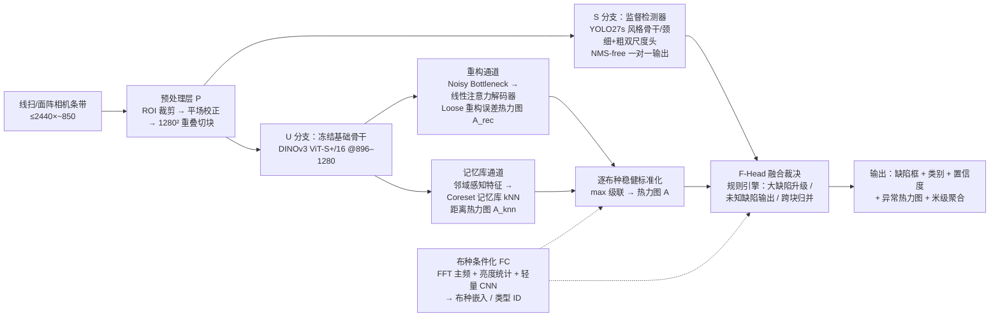

# FADNet-RT：实时布匹缺陷检测新模型总体设计

> 版本：v0.1（设计评审稿）　日期：2026-10-14
> 强制参考实现：**Dinomaly**（CVPR 2025，多类统一 UAD）、**PatchCore**（CVPR 2022，记忆库 UAD）、**Ultralytics YOLO27**（官方预览文档，2026）
> 前置条件速览：DINOv2 权重为 CC BY-NC（非商用），本案骨干默认改用 **DINOv3**（2025-08 发布，商用授权更友好，架构即插即用）；YOLO27 官方权重/代码截至本文日期**尚未发布**（官方文档注明"最终研发中"），S 分支按其公开设计要点先行自训，权重发布后无缝替换。

---

## 0. 一页摘要

布匹缺陷检测的三项目标——**大缺陷零漏检**、**已知缺陷分类精准**、**实时（1280×1280）**——单靠"纯监督检测器"或"纯无监督异常检测"都无法同时满足：前者对未见过的缺陷形态天然漏检，后者不具备类别判别能力。FADNet-RT 采用 **"双分支 + 仲裁"** 架构：

- **S 分支（有监督）**：参考 YOLO27 N/S 的设计（细/粗**双尺度检测头**、加宽早期高分辨率 stage、训练期前景对齐监督、NMS-free 一对一检测头），负责已知缺陷类别的**精准分类与定位**；
- **U 分支（无监督）**：将 Dinomaly 与 PatchCore 融合于同一冻结基础骨干之上——**Dinomaly 重构通道**（基础 ViT 特征 → 噪声瓶颈 → 线性注意力解码器 → 宽松重构）抓**结构性异常**，**PatchCore 通道**（邻域感知块特征 → Coreset 记忆库 → GPU kNN 打分）抓**细纹理偏差**，双信号互补，负责**"大缺陷绝不漏"的工程保险**与未知缺陷兜底；
- **F-Head（融合裁决）**：确定性规则引擎，将两路输出按"召回优先"原则归并：异常大区域自动升级为必报，未被检测框覆盖的异常区输出"未知缺陷（待判定）"，绝不丢弃；
- **布种统一**：所有布种共用一个模型（Dinomaly 的"多类统一"哲学），布种变化的三要素（经纬线粗细、经纬密、反光）用**条件化 + 定向数据增强**解决，换布种不需换模型，仅需（自动）更新阈值/平场参数。

预估性能（L4 级 GPU，FP16/TensorRT，估算值，以 PoC 实测为准）：单帧 1280×1280 端到端 **≈18–25 ms（40–55 FPS）**；边缘档（Jetson Orin NX，INT8 + 蒸馏）≈30–40 ms。

---

## 1. 需求与约束

### 1.1 验收指标（建议值，`[?]` 表示待业务确认）

| 维度 | 指标 | 目标 |
|---|---|---|
| 召回 | **大缺陷**（当量直径 ≥ 8 mm `[?]`，或面积 ≥ A_large `[?]`）漏检率 | **0**（验收期阴影模式 ≥1 周） |
| 召回 | 中小缺陷召回率 | ≥ 98% `[?]` |
| 分类 | 已知缺陷类 top-1 准确率（宏平均） | ≥ 96% `[?]` |
| 误报 | 假报警频次 | ≤ 1 次 / 10 m 布长 `[?]` |
| 实时 | 单帧 1280×1280 P95 端到端时延 | ≤ 33 ms（≥30 FPS）`[?]`，含预处理与裁决 |
| 布种 | 换布种 | 不换模型；阈值/照明参数自动或半自动切换 |
| 开放性 | 未知缺陷 | 不判类，但**必报**（输出区域 + 异常分） |

**"大缺陷"的业务定义必须先行冻结**，建议按"等效纱距数"定义（如跨 ≥ 8 根纱 `[?]`），与分辨率解耦，便于换布种/换相机后保持定义稳定。

### 1.2 输入与产线形态

- 目标规范输入：1280×1280。
- 现有样本为横向条带（1840–2440 × 800–850，BMP，文件名为 `机台号_日期_时间_序号`），疑似线扫相机按行拼接的输出。推理管线按"条带 → ROI → 1280×1280 重叠切块 → 帧级结果按布长聚合（米级计数/标记）"设计，与 1280² 规范兼容。
- 样本中可见**严重照明暗角**（四角均值 55–84，中心 192，约 2.8× 亮度梯度）——必须有平场校正（见 §3.2）。
- 实测细纹理周期约 **1.6–2.8 px**，已接近奈奎斯特极限（疑似欠采样/摩尔纹）。建议在 PoC 期复核相机光学分辨率与纱距匹配关系（Q4，§8）；模型侧处理见 §3.4 与 §4.3。

### 1.3 布种变化建模

布种只影响三件事：**经纬线粗细、经纬密、反光**。三者均可参数化：

- 粗细/经纬密 = 纹理的**频域主频位置与线宽比**（用 FFT 主峰估计，样本实测即可提取）；
- 反光 = **亮度场/高光分布**（平场 + 高光掩膜统计）。

因此统一模型靠三条手段叠加实现**免布种登记**的自适应（§3.5，2026-10 修订）：① 训练增强按"三要素随机采样"覆盖全空间（§4.3）；② U 分支前景-背景分离信号 + 特征/分数两级"逐 tile 去布种风格"（style_center + self_normalize），阈值全局通用；③ 单一全局 PatchCore 记忆库（不分桶）。换布种零配置、零标定。

### 1.4 现有样本分析（本仓库 `data/` 实测）

| 实测项 | 数值 | 设计含义 |
|---|---|---|
| 图像尺寸 | 最大 2440×846 | 条带切块管线；ROI 需先切掉非布空白区（部分图左侧大片空白） |
| 暗角 | 中心/四角 ≈ 2.8× | 平场校正为**必选**前处理；训练增强加入亮度渐变 |
| 细纹理周期 | ≈1.6–2.8 px | 接近采样极限，见 Q4；U 分支输入分辨率不宜再降 |
| 深色弧/线状结构 | 例：单条约 950 px 长、对比度 ≈56 灰阶 | 形态疑似**记号笔圈划标注**（检疵档案常见做法）——Q1 待确认；若为真实缺陷则归入"线状异物"类 |

---

## 2. 参考工作的借鉴映射

| 参考工作 | 借鉴内容（论文/官方实现原文要点） | 落在 FADNet-RT 的模块 |
|---|---|---|
| **Dinomaly** (CVPR'25) | ① 冻结基础 ViT（DINOv2，本案用 DINOv3）提取通用特征；② Noisy Bottleneck——用已有 Dropout 完成噪声注入，抑制恒等映射；③ **线性注意力解码器**（"天然不会聚焦"，不易抄捷径）；④ Loose Reconstruction——不强制逐层逐点对应的重构损失；⑤ 多类统一（multi-class unified）哲学——一个模型吃所有布种 | U 分支重构通道（§3.4.1）；训练配方（§5.2） |
| **PatchCore** (CVPR'22) | ① 中层特征 + **邻域感知块特征**聚合（3×3 邻域池化）；② 正常样本特征建记忆库；③ 贪心 k-center **Coreset 下采样**（≈1–10%）控制在内存/算力预算内；④ kNN 距离 + 最近邻重加权打分；⑤ 上采样 + 高斯平滑出热力图 | U 分支记忆库通道（§3.4.2） |
| **Ultralytics YOLO27**（官方预览文档） | ① N/S 尺度**细+粗双尺度检测头**（去掉中间尺度头，提速且训练等效）；② 加宽早期高分辨率 stage 强化小目标；③ **前景对齐监督**（仅训练期存在的轻量分支，部署零成本，把训练-部署精度差从 0.9 mAP 压到 0.4 mAP）；④ NMS-free 一对一检测头部署；⑤ 统一 `YOLO()` 接口，权重发布后原位替换 | S 分支（§3.3） |

> YOLO27 现状（2026-10-14 核查官方文档）：四档 N/S/M/L，COCO 42.3–60.4 mAP @ 0.62–2.32 ms（RTX PRO 6000，640 输入）；N/S 为精简 CNN，M/L 为查询式（transformer decoder）NMS-free 架构；**权重与配置尚未公开发布**。工程对策见 §6.4。

---

## 3. 总体架构

### 3.1 架构总览



### 3.2 预处理层 P

1. **ROI 裁剪**：检测布面有效区（亮度/纹理能量阈值 + 形态学），去掉样本中可见的大片空白边——直接减少需处理像素，是最便宜的提速。
2. **平场校正**：用最近 N 帧滚动均值估计照明场（分行更新，跟随灯管缓漂），`I := I / E × 中位数亮度`，把 2.8× 暗角压平到 ±5% 以内；估计用降采样(1/16)进行，GPU 上 <0.5 ms。
3. **Tiling**：有效区按 1280×1280、15% 重叠切块；不足处镜像补齐。块内位置编码写入全局坐标，供 §3.6 跨块归并。

### 3.3 S 分支：监督检测器（YOLO27s 风格）

按 YOLO27 N/S 公开设计要点实现（`configs/det_yolo27s_fabric.yaml`）：

- **骨干/颈**：YOLO26/27 系列风格的纯卷积骨干；**加宽最早期高分辨率 stage**（约 1.25×），因为布疵最小尺度只有几像素横向宽度；
- **双尺度检测头**：只挂 fine（stride 4–8 `[tune]`）与 coarse（stride 32）两个检测头，去掉中间尺度头，按文档所述以固定缩放保持两尺度平衡——这正是"去掉一大块检测头计算"的提速点，同时恰好匹配布疵尺度分布（细线类→fine 头，大片污渍/稀弄→coarse 头）；
- **前景对齐监督**：训练期额外挂一个轻量"前景/背景"逐位置分类分支，拉近 one-to-many 监督与部署用 one-to-one 头之间的精度差；**导出/部署时整支裁掉，零推理成本**；
- **NMS-free**：部署用一对一检测头（`nms=False` 等价路径），规避线扫长条带上 NMS 对密集小疵点的误抑制，也消除长尾后处理延迟；
- **类别头**：已知缺陷 K 类（§4.1 清单草案，待确认），类别置信度带温度标定。

输入分辨率 1280 原生训练。最小可检出目标按 8×8 px 设计（fine 头 stride 4 时 anchor 尺度覆盖）。

> 说明：YOLO27 官方权重未发布，以上为按其文档设计要点的自训实现；官方发布后通过统一 `YOLO()` 接口不做代码改动地替换权重与 YAML。

### 3.4 U 分支：Dinomaly + PatchCore 双流异常检测

两通道共享同一个**冻结**基础骨干（DINOv3 ViT-S+/16，29M，registers 版）——这是 Dinomaly "Foundation Transformer" 要点的直接沿用；冻结骨干意味着 U 分支训练只学小量的解码器与统计量，**一天内可出结果**。

#### 3.4.1 重构通道（Dinomaly 风格）

- 输入 @896（可调 896–1280；热力图再上采样回原图尺度，异常图本身平滑，分辨率损失不影响"大缺陷不漏"）；
- 取骨干中层 token（默认第 3/5/7/9 层）；
- **Noisy Bottleneck**：token 序列过 Dropout(p=0.2) 作为唯一噪声注入（Dinomaly 原文的核心发现：已有 Dropout 即可完成 noisy bottleneck）；
- **线性注意力解码器**：2–3 层 Linear-Attention + MLP，输出分组重构特征；
- **Loose Reconstruction**：不以"第 i 层解码 ↔ 第 i 层编码"硬性对齐，采用组间宽松对应 + 余弦距离损失（异常图 = 各分组 `1 − cos(f_enc, f_dec)` 的均值，再上采样 + 高斯平滑）；
- 训练**只用正常样本**（见 §5.2）；布种变化由统一训练 + §3.5 条件化共同吸收。

#### 3.4.2 记忆库通道（PatchCore 风格）

- 同一骨干取中层特征图（token 网格 ≈ 56² @896），做**邻域感知聚合**：特征图 3×3 均值池化（stride 1）后再取中心特征拼接/池化，得到局部上下文感知的块特征（PatchCore 的 locally-aware patch feature）；
- **构建记忆库**：正常样本训练集全量块特征 → 随机 10% → **贪心 k-center Coreset** 压到 ≈8k 中心 × 384 维（≈12 MB，显存常驻）；
- **打分**：测试块特征与记忆库 1-NN GPU 距离（torch.cdist 分块，<1 ms），按 PatchCore 原文用最近 4 邻距离重加权；距离图双线性上采样 + 高斯 σ=4 平滑得 A_knn。

#### 3.4.3 双信号级联

`A = max( z_rec(A_rec), z_knn(A_knn) )`

其中 `z_*` 为逐布种的稳健标准化（正常训练集逐布种算 1%/99% 分位数做 [0,1] 截断归一化）。取 `max` 的考虑：两通道异常响应机理不同（结构 vs 纹理），召回优先场景下任何一个报警都应放大；精度损失由 F-Head 的合并/复核规则回收。后续数据充足时可换成 2 特征 × 小型标定逻辑回归（参数 <10 个，验证集上拟合）。

### 3.5 布种不变性（免登记自适应，2026-10 修订）

**业务约束**：产线无法提供布种登记/MES 布种代码。设计目标改为：模型对任意布种开箱即用，只关心缺陷前景。

原理：Dinomaly 重构残差与 PatchCore 库距离天然是**前景-背景分离**信号——任何布种的正常纹理都能被冻结骨干"解释"（可重构、近库），缺陷不能。布种三要素只造成**整体性**偏移（特征均值方向、分数尺度），不改变"缺陷相对背景"的结构，因此两级去除即可全局通用：

1. **特征级 style_center**：入库与查询前对每个 tile 的特征图减该 tile 均值方向，剥离经纬密/粗细/反光造成的风格偏移 → **单一全局记忆库**（Coreset 8k），不分桶、不查表；
2. **分数级 self_normalize**：融合前对 A_rec、A_knn 逐 tile 自归一化——以本 tile 背景中位数为基线、(p90−p50) 为尺度换算成"背景尺度倍数" z。背景 z 分布跨布种/跨光照稳定（大缺陷 ≤30% 面积时中位数仍由背景主导），故 **τ_u、τ_large 全局唯一**（configs/thresholds.yaml）；
3. **增强级**：三要素随机采样增强（§4.3）保证骨干特征对三要素不变，与 1/2 互为冗余。

保留项（仅台账/可视化，不进模型与阈值）：FFT 布种画像（主频间距/线宽比/高光统计）写入缺陷台账供追溯；MES 布种代码可作可选字段。**新布种上线零配置**；若阴影期发现某新布种误报漂移，用其正常样本重算全局分位数即可（仍无逐布种表）。

### 3.6 F-Head：融合裁决规则引擎（"大缺陷不漏"的核心）

输入 = {S 分支框列表（低置信截断 τ_det_low=0.05 召回优先）, U 热力图 A, 布种 ID}。规则按序执行：

1. **异常区提取**：A 按阈值 τ_u（§7.2 标定）二值化 → 连通域 → 面积 ≥ min_area（≈3×3 异常格）的区保留为候选区 R；
2. **大缺陷升级**：面积 ≥ A_large **或** 最高分 ≥ τ_large 的 R 直接置 grade=critical，**必报**，绕过任何后续抑制逻辑；
3. **框-区合并**：检测框 B 与候选区 R 的 IoU > 0 即关联：`score = max(conf(B), w·score(R))`，类别取 B 的类别（B 低于分类阈值 → 类目标记"异常（待判定）"）；
4. **孤立异常区**：无框覆盖的 R 输出 `class = "未知缺陷"`，置信度 = 归一化异常分，`review_flag = true`，**绝不丢弃**——这是未知形态缺陷与"大缺陷不漏"的双保险；
5. **低置信孤立框**：低于 τ_det_heavy 且无 R 支撑的框降级为 review（不计入自动判废，只入日志复核），控制误报；
6. **跨块归并**：投回条带全局坐标后对相邻块结果做 IoU 0.5 去重（一对一头的输出已稀疏，成本极低），再按布长方向聚合成米级缺陷台账；
7. **逐类置信度标定（置信度 ↔ 严重度，2026-10 用户要求）**：每个缺陷类独立温度系数 T_c（验证集 NLL 拟合），对外 `conf = sigmoid(logit(raw)/T_c) ≈ P(该类缺陷存在)`；严重度 `severity = w1·conf + w2·clip(z/6) + w3·log1p(area)/log1p(25000)`，权重与等级门限**逐类独立**（configs/class_calibration.yaml）；grade 由该类 severity 门限给出，但规则 2 的"大缺陷必报 critical"优先级最高、标定不降级。

输出协议（每缺陷，JSON）：

```json
{"tile_id": "...", "box_xywh": [..], "class": "foreign_fiber", "conf": 0.93,
 "anomaly_score": 4.6, "severity": 0.81, "grade": "critical|major|minor|review",
 "evidence": {"det": true, "anom": true, "raw_conf": 0.88}, "fabric_id": "KBA26...(仅台账)"}
```

### 3.7 目标 ↔ 设计映射

| 目标 | 由什么保证 |
|---|---|
| 大缺陷零漏检 | U 分支双通道异常热力图（无监督、与缺陷形态无关）+ F-Head 规则 2/4（大面积/高分直接升级、孤立区不丢弃）+ 低阈值召回优先 + 标定流程以"大缺陷 min-score − 裕量"设阈值（§7.2） |
| 分类精准 | S 分支监督检测（K 类）+ 类均衡采样与难例挖掘 + 方向性缺陷（断经/断纬、条影方向）几何先验约束 + 低置信类间差异 <0.1 时输出复核而非强猜 |
| 实时 | 双尺度头去中间头 + NMS-free 一对一 + 训练期分支部署裁掉（YOLO27 要点）；U 分支冻结骨干一次前向、线性注意力解码器、Coreset 压缩 kNN <1 ms；双分支 GPU 流水线并行 |
| 换布种 | 三要素增强训练统一模型（Dinomaly 多类统一哲学）+ FC 条件化 + 分桶记忆库 + 逐布种阈值表 |

---

## 4. 数据方案

### 4.1 标注规范（类别清单为草案，`[?]` 待业务终版）

框级薄标注（YOLO 格式）+ 大缺陷加掩膜级标注（供像素级 AP/阈值标定）。建议类别：

```
broken_warp 断经 | broken_weft 断纬 | thin_thick_weft 稀纬/密纬(档)
double_pick 双纬 | slub 竹节 | skip_draw 跳花/错花 | hole 破洞
knot 结头 | stain_oil 油污渍 | foreign_fiber 异纤/飞花(含线状异物)
streak_bar 条影/经柳纬档 | edge_defect 边疵 | other_known 其它已知
unknown_anomaly 未知缺陷(仅系统输出，不人工标注此类训练框)
```

方向性类（断经/断纬、档的方向）标注时须与布料走行方向记录一致，供几何先验校验。

**Q1（待确认）**：`data/` 中深色弧线疑似记号笔圈划。若确为标注笔迹：提供"笔迹→缺陷位置"对应表，训练时笔迹像素掩膜覆盖（不计损失、不入记忆库）；若为真实缺陷：归入 `foreign_fiber`/线状异物类。

### 4.2 合成缺陷引擎（布料感知版 CutPaste/DRAEM）

异常样本通常稀缺且类别长尾，合成引擎是 S 分支冷启动的关键（`src/fadnet/augment/synthdefects.py` 已给出可运行骨架）：

- **频域锁定**：每批先用 FFT 估计当前布面主频/线宽，生成的断经/断纬条纹宽度严格等于 1–3 根纱距，方向锁定经纬轴（±2° 抖动）；
- 形态库：断续线（断经/纬）、条带（稀密档）、贝塞尔细线（异纤/毛发）、低频 Perlin 团块（油污）、椭圆孔+毛刺边（破洞）、小团块（结头）；
- 混合：alpha 混合随亮度场调制，模拟"缺陷融入真实照明"；
- 自动产出 YOLO 格式框标签；合成缺陷同时作为 U 分支**仅测试**数据（不入 U 训练集，保持无监督纯度）。

### 4.3 三要素增强（覆盖布种空间）

- 粗细/经纬密：频域重采样——对正常图做主频轴向上的 ±20% 频移 + 线宽带通调制（空域近似：各向异性缩放/网格形变 + 锐化核族）；
- 反光：随机亮度场（二次曲面/正弦扫描场 ±40%）、高光斑（镜面高斯斑 α≤0.3）、实测的 2.8× 暗角分布作为增强先验；
- 常规：平移/翻转（经纬语义保持映射类名！翻转后断经⇄断纬需联动改类）、轻噪声、JPEG 不用于线扫无损链路。

### 4.4 数据闭环

线上 `unknown_anomaly` 与 review 样本全量存盘（含热力图）→ 周级人工判定 → 已知类入 S 训练集/新类评估 → U 分支 normal 记忆库季度滚动更新（防布面缓漂）。这是"分类越用越准 + 不漏"双目标的运维保障。

---

## 5. 训练方案

### 5.1 阶段 S1：S 分支监督训练

- 预训练：Ultralytics 官方 COCO 预训练骨干（YOLO27 发布后替换官方权重）；
- 数据：真实异常标注 + 合成缺陷（配比 1:2 起步）+ 正常图作背景；
- 配方：Ultralytics 默认优化器族（SGD/AdamW 自动选择）+ 类均衡采样 + 难例挖掘（每 5 epochs 全量重打分提升 top-FP 样本权重）；前景对齐分支参与训练；
- 验证重点：小目标（<16 px）Recall、方向性类混淆矩阵。

### 5.2 阶段 S2：U 分支训练（互不影响骨干，可分卡并行）

- 重构通道：正常样本 only；AdamW，lr 1e-4，cosine 衰减，~20k iters（Dinomaly 官方配方基线，2× 迭代收益在官方权重表里已验证）；损失 = Loose 余弦重构（分组宽松对应）+ 特征范数正则；
- 记忆库通道：同批正常样本过一次冻结骨干 → Coreset 构建（零梯度训练）；
- 标定：各布种正常验证集分别算 A_rec/A_knn 的 1%/99% 分位，写入 `fabric_thresholds.yaml`。

### 5.3 阶段 S3：联合校准（可选精修）

双分支冻结，只在含异常的小验证集上学：归一化权重 w、可选逻辑标定（10 个参数以内）、类别温度。杜绝过拟合已知异常而伤害开放性。

### 5.4 算力

S1：单张 RTX 4090/A100 × 1–2 天；S2：单卡 ≤1 天；S3：分钟级。PoC 阶段总量友好。

---

## 6. 实时性与部署

### 6.1 延迟预算（单块 1280×1280，L4 级 GPU，FP16/TensorRT；估算，PoC 实测回填）

| 模块 | 估算耗时 |
|---|---|
| P：ROI + 平场 + 切块（GPU fuse） | ~1.0 ms |
| S 分支 YOLO27s 风格 @1280 | 4–9 ms |
| U 骨干前向 ViT-S+/16 @896 | 5–9 ms |
| 线性注意力解码器（2–3 层，推理期 Dropout 关闭） | ~1.5 ms |
| kNN（8k×384，GPU 分块 cdist） | <1 ms |
| 热力图融合 + 连通域 + F-Head | ~2 ms |
| **合计（串行上界）** | **≈16–24 ms** |

双分支可异步流水（两份 feature 并行），P95 目标 ≤ 25 ms；结合 ROI 裁剪去掉的非布像素，整帧条带吞吐约 40–55 FPS 等效。

### 6.2 边缘档

- INT8 PTQ/QAT + U 分支教师（ViT-B）→ 学生（ViT-S+ 或 ConvNeXt-T，DINomaly 官方仓库自带 FLOPs 剖析工具可选型）蒸馏；
- Orin NX 估算 30–40 ms；若仍需更低，提供"U 主 S 辅"降级模式（异常常开，检测分类降帧按需），保住"不漏"底线。

### 6.3 工程化

TensorRT engine 固化 + 记忆库引擎内 INT8 量化（余弦等价性验证后）+ 阈值表版本管理；gRPC/共享内存与产线 PLC 对接（报警级 grade → 停机/标记动作表 `[?]`）。

### 6.4 YOLO27 切换路径

官方权重与配置发布后：`YOLO("yolo27s.pt")` 原生加载 → COCO 预训练 → 按本方案数据继续 fine-tune；YAML 中双尺度头/前景对齐为官方内建项，无需改训练代码。切换前后在冻结验证集上做 A/B，验收不退化才替换。

---

## 7. 评估与验收

### 7.1 指标集

- 按面积分桶（小 <8 mm / 中 8–20 / 大 >20 mm `[?]`）的 Recall 曲线；**大桶 Recall 必须 = 1.0**；
- 已知类 top-1 / 宏平均 Acc、混淆矩阵、复核拒绝率；
- FP/米、FP/卷；image/pixel AUROC 仅作 U 分支内部参考，不作验收门槛；
- P50/P95 时延分解表（§6.1 回填实测）。

### 7.2 阈值标定流程（全局一次，免布种登记）

在**自归一化 z 空间**标定（z = 背景尺度倍数，跨布种可比）：

1. 正常验证集（覆盖全部在产布种）→ τ_u = z 的 p99（即 FPR ≤ 1% 工作点）；
2. 含全部大缺陷的 calib 集 → 取大缺陷最高 z 的**最小值** m，τ_large = m − 5% 裕量，且 τ_u ≤ τ_large（违反则以"不漏"优先上调）；
3. 两者写入 `configs/thresholds.yaml` **全局唯一**；逐类置信度温度/严重度权重由验证集匹配记录拟合写入 `configs/class_calibration.yaml`（§3.6 规则 7）；
4. 新布种零配置上线；阴影期若某布种 FPR 漂移 > 预算，把该布种正常样本并入验证集重算分位数（仍是全局单表）。

### 7.3 验收清单

- 阴影模式 ≥1 周：系统输出与人工验布比对，大缺陷差异数 = 0；
- 已知类 Acc ≥ 96%（逐类列示）；FP ≤ 预算；
- 连跑 72h 无内存增长、时延无漂移（平场滚动窗口老化检查）；
- 断流/换布种/换卷场景演练通过。

---

## 8. 风险与未决问题（待您确认）

| # | 问题 | 影响 | 建议 |
|---|---|---|---|
| Q1 | `data/` 中深色弧线是笔迹标注还是真实缺陷？ | 数据清洗策略 | 提供标注说明；若是笔迹需掩膜剔除 |
| Q2 | 缺陷类别终版清单与每类典型图例 | S 分支类别头 | 按 §4.1 草案评审修订 |
| Q3 | 目标硬件（L4/4090/Orin NX？）与"实时"门槛（30/60 FPS？） | 模型档位与蒸馏深度 | 以 §6.1 预算反推确认 |
| Q4 | 细纹理周期 ≈2 px 接近奈奎斯特，是否有更高分辨率档位/光学方案？ | 小疵点检出上限 | PoC 期复测 MTF；必要时 U 分支保持 1280 不降采样 |
| Q5 | ~~MES 能否提供当前布种代码/配方号？~~ **已解决（2026-10）**：产线无法登记布种 | — | 改为免登记设计（§3.5）：style_center + self_normalize + 全局单库；MES 代码仅作可选台账字段 |
| Q6 | "大缺陷"业务定义（mm/纱距数）与判定动作（停机/标记） | 验收标准冻结 | 与质检口径对齐后写入 §1.1 |
| Q7 | 正常样本量与布种数（每布种 ≥500 张正常帧建议起步） | U 分支质量 | 不足则合成 + 跨布种借用 |
| Q8 | 许可：DINOv3 权重需 Meta 官网申请（商用较 DINOv2 的 CC BY-NC 友好）；Ultralytics 商用需 Enterprise License `[?]` | 合规 | 法务确认；备选：自蒸馏教师/开源许可骨干替换 |

---

## 9. 里程碑（建议 8–10 周）

| 周 | 里程碑 |
|---|---|
| W1–2 | M1 数据打通：Q1–Q7 澄清、标注规范冻结、合成引擎上线、PoC 训练集 v1 |
| W3–4 | M2 S 分支基线（YOLO27s 风格自训）；小目标 Recall 首版报告 |
| W5–6 | M3 U 分支（重构 + 记忆库）训练与热力图 v1；逐布种标定流程跑通 |
| W7–8 | M4 F-Head 联调 + 端到端 benchmark（延迟实测回填 §6.1）+ 蒸馏/量化评估 |
| W9–10 | M5 产线阴影模式试运行 → 验收评审 |

---

## 10. 参考资料与许可注意

- Dinomaly 官方实现：https://github.com/guojiajeremy/Dinomaly （CVPR 2025；Dinomaly2 预览版 2026-05 发布，支持 160/380 类超大多类，可作后续升级参照）
- PatchCore 官方实现：https://github.com/amazon-science/patchcore-inspection
- Ultralytics YOLO27 官方文档：https://docs.ultralytics.com/models/yolo27 （截至 2026-10：预览状态，权重未发布）
- DINOv3：https://github.com/facebookresearch/dinov3 （权重需在 Meta 模型库页面申请；商用条款由法务确认；DINOv2 为 CC BY-NC，商用禁用）
- 合成缺陷思路：CutPaste（Li et al. 2021）、DRAEM（Zavrtanik et al. 2021）的布料频域约束变体
